  

 
 

### What I work on

I'm a **Cybersecurity Engineer at [Alpitronic](https://www.alpitronic.it)** in Bologna, building detections, threat hunts and AI-driven SOC automation for large-scale EV fast-charging infrastructure, mostly on the Elastic Stack.

- **AI in the SOC**: LLM-based alert triage in production that closes false positives and escalates real incidents, cutting repetitive manual triage by about 90%.
- **Agentic tooling**: MCP servers over internal data so AI agents can fetch, correlate and act across tools.
- **Detection engineering**: MITRE ATT&CK-mapped rules for EV-charger threats, from NFC card cloning to web attacks, plus threat hunts that turn findings into new detections.
- **ML anomaly detection**: a DBSCAN model with geo-enrichment that spots cloned charging cards across 40,000+ chargers and raises regional alerts in real time.
- **Security data engineering**: Python and Logstash pipelines for log onboarding, parsing and enrichment, and alert-to-case integration so every incident is tracked to closure.

<b>Toolbox, background and more projects</b>

**Toolbox**

- **Security**: detection engineering, threat hunting, SIEM, SOAR, incident response, MITRE ATT&CK, threat intel
- **Elastic Stack**: Elastic Security, Elasticsearch, Kibana, Logstash, ES|QL, EQL, ML jobs, Elastic Cloud
- **AI and automation**: LLM alert triage, agentic AI, MCP, Claude API, prompt engineering, REST APIs, webhooks
- **Code and data**: Python, SQL, ETL pipelines, Docker, Linux, Git, C / C++
- **Electronics**: analog circuit design, LTspice, ESP32, Arduino, PCB design

**Background**

- **MSc Electronic Engineering**, University of Bologna. Thesis: *Cybersecurity Monitoring and Threat Detection for Large-Scale EV Charging Infrastructure: Design and Implementation of a SIEM Platform Using the Elastic Stack.*
- **BTech Electronics and Communication Engineering**, UIT RGPV, Bhopal.
- **Anthropic certifications (2026)**: Claude Code in Action, Claude Platform 101, Subagents, Agent Skills, AI Fluency.

**More projects**

- [sentence-reconstruction-seq2seq](https://github.com/theommishra-dev/sentence-reconstruction-seq2seq): rebuilds a sentence from its shuffled words with an LSTM encoder-decoder and attention.
- [cmos-two-stage-opamp](https://github.com/theommishra-dev/cmos-two-stage-opamp) · [cmos-low-voltage-opamp](https://github.com/theommishra-dev/cmos-low-voltage-opamp): two CMOS op-amps sized by hand from a spec sheet and verified in LTspice.

### Get in touch

Open to roles in **detection engineering, SOC and security automation with AI/ML**. The best way to reach me is [LinkedIn](https://www.linkedin.com/in/theommishra). On YouTube I run **[The Om Vlogs | In Italy](https://www.youtube.com/@TheOmVlogsOfficial)**, helping Indian students plan study and careers in Italy and Europe.

The cards above are animated SVGs drawn by <code>scripts/render_readme_cards.py</code> and refreshed daily by a GitHub Action.
